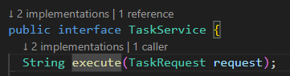
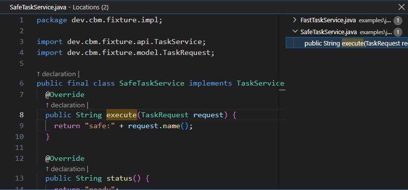

# CBM Navigator

[简体中文](README_CN.md)

CBM Navigator is a lightweight, high-performance code navigation extension for VS Code, built for the AI coding era. It combines editor-aware source analysis with the shared semantic graph maintained by [codebase-memory-mcp](https://github.com/DeusData/codebase-memory-mcp) to deliver fast, precise navigation while keeping the extension lightweight.

## What it does

- `Ctrl+Click` / `F12` on an invocation: a unique reliable concrete implementation opens directly; multiple implementations open in Peek; the declaration remains the fallback when no implementation exists.
- `Ctrl+Click` / `F12` on a method or constructor declaration: verified callers of its interface/implementation family open in Peek.
- `Ctrl+Click` / `F12` on a type or field declaration: verified references open in Peek.
- CodeLens above supported declarations shows `↑ declaration`, `↓ N implementations`, `N callers`, and `N references` when verified relationships exist.
- `Ctrl+F12`: implementations.
- `Shift+F12`: verified references.
- **CBM Navigator: Go to Declaration**: bypasses implementation promotion.
- Optional IDEA bindings: `Ctrl+B`, `Ctrl+Alt+B`, and `Alt+F7`.
- Reads the current editor document, including unsaved changes, through a bundled Tree-sitter WASM Worker. No language runtime or build tool is launched.

The extension deliberately returns no target when only unsafe or unresolved candidates remain.

## Feature tour

### Explicit, visible indexing

Before opening an MCP session, CBM Navigator reads CBM's `auto_index` setting with the local `config get auto_index` command, which has a 30-second timeout. When the setting is `true` or cannot be read, the extension stays disconnected and shows **CBM: Connect**. Click it, or run **CBM Navigator: Connect / Retry Connection**, to review and confirm the connection. Connecting may start automatic indexing of the workspace folders.

When `auto_index` is `false`, the extension connects automatically. The status bar shows **CBM: Connecting…** during the check and connection, then displays the resulting connection or index status. CBM's shared indexing and watcher settings apply once connected.

| Index required | Ready to navigate |
|---|---|
|  |  |

### Relationships at a glance

CodeLens surfaces verified declarations, implementations, callers, and references directly above supported symbols.



### Multiple targets without losing context

When more than one reliable target exists, CBM Navigator opens VS Code's built-in Peek view so you can inspect and choose the right result in place.



## Requirements and setup

CBM Navigator (`sxcooler.cbm-vscode-navigator`) requires VS Code `1.135.0` or newer and codebase-memory-mcp `0.10.8` or newer. The required CBM tools are `index_repository`, `list_projects`, `index_status`, `check_index_coverage`, `search_graph`, `query_graph`, `trace_path`, and `get_graph_schema`.

Download the VSIX from [GitHub Releases](https://github.com/sxcooler/cbm-vscode-navigator/releases/latest), then run **Extensions: Install from VSIX...** in VS Code.

The executable search order is:

1. `cbmNavigator.executablePath`;
2. the process `PATH`;
3. official per-platform installation locations.

Use **CBM Navigator: Set Up CBM** to select an existing executable or begin a verified shared installation. Downloads come from the official GitHub release, every redirect is origin-checked, and the archive SHA-256 must match `checksums.txt`. The candidate runs `install --dry-run`; the shared installer is invoked only after a second modal confirmation.

Once connected, use **CBM Navigator: Index Current Workspace** to explicitly index a root and approve the displayed canonical path. This command uses CBM `fast` mode, and all CBM, Git, repository, and user exclusions remain authoritative. An approved manual connection can also let CBM's own `auto_index` setting start indexing before this command is used.

## Multi-root workspaces

After the connection check or manual approval, every trusted workspace root gets its own long-lived stdio MCP frontend with `CBM_ALLOWED_ROOT` set to the canonical root. Frontends share CBM's account daemon and graph cache. A returned source path is canonicalized, checked for root containment, read, and token-validated before VS Code receives it.

## Privacy and security

Source code, symbol context, graph queries, and graph results remain local. Network access is limited to user-approved installation/upgrade and optional release metadata checks. In an untrusted workspace the extension does not start CBM, index, query graphs, install software, or navigate to graph paths.

Processes are launched by executable path plus argument arrays, never concatenated shell commands. The extension does not pipe remote scripts into a shell, alter PowerShell execution policy, overwrite an active binary, or restart unrelated agent sessions.

## Settings

| Setting | Default | Purpose |
|---|---:|---|
| `cbmNavigator.executablePath` | empty | Explicit CBM executable |
| `cbmNavigator.minimumDirectJumpConfidence` | `0.85` | Silent direct-jump threshold |
| `cbmNavigator.queryTimeoutMs` | `5000` | Timeout for each navigation graph request in milliseconds |
| `cbmNavigator.updateCheck.enabled` | `true` | Low-frequency release metadata checks |
| `cbmNavigator.keymap` | `vscode` | `vscode` or `idea` contributed bindings |

## Troubleshooting

- **CBM: Connect** — automatic indexing is enabled or its setting could not be read. Hover for the reason, then click to connect manually. Connecting may start CBM background indexing.
- **CBM: Connecting…** — the extension is checking the local runtime/configuration or establishing a connection; click to show logs.
- **CBM: Install** — no executable passed the version probe. Select a known executable or use verified setup.
- **CBM: Upgrade** — the executable is older than `0.10.8` or lacks required MCP tools.
- **CBM: Index** — the runtime is compatible but this canonical root has no project index.
- **CBM: Error / Degraded** — open **CBM Navigator: Show Logs**, then run **CBM Navigator: Connect / Retry Connection**.
- A symbol may intentionally have no result when graph coverage, path checks, receiver/signature evidence, or source validation cannot establish a safe target.

## Development

```sh
npm install
npm test
npm run check
npm run build
npm run test:integration
npm run package
```

The parser tests and the default integration workspace use the fictional Java project in `examples/java`. Set `CBM_TEST_EXECUTABLE` before `npm run test:contract` to verify a real CBM executable's capabilities. Without an executable, CBM-backed contracts report explicit skips.

An optional live declaration-family check also accepts `CBM_TEST_WORKSPACE_ROOT`, `CBM_TEST_SYMBOL`, `CBM_TEST_RECEIVER`, `CBM_TEST_ARITY`, `CBM_TEST_DECLARATION_FILE`, and the one-based `CBM_TEST_DECLARATION_LINE`. Keep project-specific values in the environment.

For publisher setup and release steps, see the [VS Code Marketplace publishing guide](docs/VS_CODE_MARKETPLACE.md).

## Known limitations

CBM Navigator currently supports Java project source only. Completion, diagnostics, refactoring, formatting, debugging, navigation into dependency or JDK source, and cross-file semantics for multiple unsaved documents are outside its current scope. Reference results may be incomplete when CBM lacks verifiable occurrence data.
