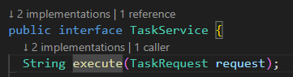
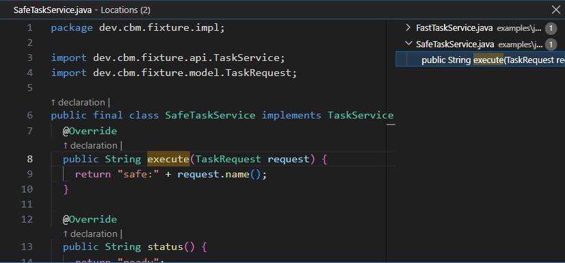

# CBM Navigator

[English](README.md)

CBM Navigator 为 VS Code 提供**轻量级 Java 代码导航，无需启动重量级语言服务器**。它面向 AI 编程场景，用内置的 Tree-sitter 解析器分析正在编辑的文件，再通过 [codebase-memory-mcp](https://github.com/DeusData/codebase-memory-mcp) 维护的本地代码图快速定位实现、调用位置和引用。

## 主要功能

- 在调用处使用 `Ctrl+Click` 或 `F12`。有唯一可靠的具体实现时直接跳转，有多个实现时打开 Peek 预览窗口，找不到实现时回退到声明。
- 在方法或构造器的声明处使用 `Ctrl+Click` 或 `F12`。在 Peek 中查看该声明及其对应接口、实现的已验证调用位置。
- 在类型或字段的声明处使用 `Ctrl+Click` 或 `F12`。在 Peek 中查看已验证的引用。
- 支持的声明上方会通过 CodeLens 显示已验证的导航关系，界面标签包括 `↑ declaration`、`↓ N implementations`、`N callers` 和 `N references`。
- `Ctrl+F12` 跳转到实现。
- `Shift+F12` 查找已验证的引用。
- **CBM Navigator: Go to Declaration** 直接定位声明，跳过优先查找实现的步骤。
- 可选用 IDEA 快捷键 `Ctrl+B`、`Ctrl+Alt+B` 和 `Alt+F7`。
- 通过内置的 Tree-sitter WASM Worker 读取当前编辑器文档，包括未保存的修改。这个过程无需启动语言运行时或构建工具。

只有能可靠解析和验证的位置才会作为导航结果返回。

## 功能一览

### 连接和索引状态

在打开 MCP 会话前，CBM Navigator 会在本地运行 `config get auto_index`，读取 CBM 的 `auto_index` 设置。这条命令的超时为 30 秒。设置为 `true` 或读取失败时，扩展保持断开，并在状态栏显示 **CBM: Connect**。点击状态栏或运行 **CBM Navigator: Connect / Retry Connection**，即可查看提示并确认连接。连接后，CBM 可能自动为工作区文件夹建立索引。

`auto_index` 为 `false` 时，扩展会自动连接。检查配置和建立连接期间，状态栏显示 **CBM: Connecting…**，随后显示连接结果或索引状态。连接建立后，索引和文件监听按 CBM 的共享配置运行。

| 需要建立索引 | 可以开始导航 |
|---|---|
|  |  |

### 在声明处查看导航关系

CodeLens 在支持的符号上方提供已验证的声明、实现、调用位置和引用入口。



### 在当前编辑器查看多个目标

有多个可靠目标时，CBM Navigator 会打开 VS Code 自带的 Peek 预览窗口，可以留在当前编辑器里查看并选择目标。



## 环境要求与配置

CBM Navigator（`sxcooler.cbm-vscode-navigator`）要求 VS Code `1.135.0` 或更高版本，以及 codebase-memory-mcp `0.10.8` 或更高版本。CBM 需要提供 `index_repository`、`list_projects`、`index_status`、`check_index_coverage`、`search_graph`、`query_graph`、`trace_path` 和 `get_graph_schema` 工具。

从 [GitHub Releases](https://github.com/sxcooler/cbm-vscode-navigator/releases/latest) 下载 VSIX，然后在 VS Code 中执行 **Extensions: Install from VSIX...**（从 VSIX 安装）。

扩展按以下顺序查找 CBM 可执行文件。

1. `cbmNavigator.executablePath` 指定的路径。
2. 当前进程的 `PATH`。
3. 当前平台的官方安装位置。

运行 **CBM Navigator: Set Up CBM**，即可选择已有的可执行文件，或开始经过校验的共享安装流程。安装包来自 GitHub 官方发行版，每次重定向都会校验来源，压缩包的 SHA-256 必须与 `checksums.txt` 一致。扩展会先用待安装的可执行文件运行 `install --dry-run`，在第二次弹窗确认后才执行共享安装。

连接后，运行 **CBM Navigator: Index Current Workspace** 并确认界面显示的规范路径，即可为该工作区根目录建立索引。此命令使用 CBM 的 `fast` 模式，遵循 CBM、Git、仓库和用户设置的排除规则。手动确认连接后，CBM 也可能根据自身的 `auto_index` 设置提前开始索引。

## 多根工作区

自动连接检查通过或手动确认后，扩展为受信任工作区中的每个根目录建立独立的 stdio MCP 长连接，并将 `CBM_ALLOWED_ROOT` 设为该根目录的规范路径。这些 MCP 前端共用当前用户的 CBM 守护进程和图缓存。扩展会先规范化返回的源码路径并确认它位于相应根目录下，再读取源码、校验词元，最后将位置交给 VS Code。

## 隐私与安全

源代码、符号上下文、图查询和查询结果均留在本地。扩展仅在用户批准安装或升级，以及启用可选的发行版元数据检查时访问网络。在不受信任的工作区中，扩展会停用 CBM 启动、索引、图查询、软件安装和图路径导航。

启动进程时，扩展将可执行文件路径与参数数组分别传入。安装流程不会将远程脚本送入 Shell 执行，也不会更改 PowerShell 执行策略、覆盖正在使用的可执行文件，或重启无关的代理会话。

## 设置

| 设置 | 默认值 | 用途 |
|---|---:|---|
| `cbmNavigator.executablePath` | 空 | 指定 CBM 可执行文件路径 |
| `cbmNavigator.minimumDirectJumpConfidence` | `0.85` | 直接跳转所需的最低置信度 |
| `cbmNavigator.queryTimeoutMs` | `5000` | 每次导航图请求的超时时间，单位为毫秒 |
| `cbmNavigator.updateCheck.enabled` | `true` | 启用低频的发行版元数据检查 |
| `cbmNavigator.keymap` | `vscode` | 选择 `vscode` 或 `idea` 快捷键方案 |

## 常见问题

- **CBM: Connect** 表示自动索引已启用，或扩展未能读取其设置。将鼠标悬停在状态栏上查看原因，点击后可手动确认连接。连接可能触发 CBM 后台索引。
- **CBM: Connecting…** 表示扩展正在检查本地运行环境、读取配置或建立连接。点击可查看日志。
- **CBM: Install** 表示没有可执行文件通过版本探测。可手动选择可用的可执行文件，或使用经过校验的安装流程。
- **CBM: Upgrade** 表示可执行文件版本低于 `0.10.8`，或缺少必需的 MCP 工具。
- **CBM: Index** 表示运行环境兼容，但当前根目录尚无项目索引。
- **CBM: Error / Degraded** 表示连接出错或功能受限。先运行 **CBM Navigator: Show Logs** 查看日志，再运行 **CBM Navigator: Connect / Retry Connection**。
- 当图索引覆盖范围、路径检查、接收者类型和签名信息，或源码校验不足以确认目标时，符号可能没有导航结果。

## 开发

```sh
npm install
npm test
npm run check
npm run build
npm run test:integration
npm run package
```

解析器测试和默认的集成测试工作区使用 `examples/java` 中的虚构 Java 项目。运行 `npm run test:contract` 前设置 `CBM_TEST_EXECUTABLE`，即可使用真实的 CBM 可执行文件验证其能力。如果未提供可执行文件，测试会明确标记依赖 CBM 的契约用例为跳过。

在已建立索引的工作区中，还可以用 `CBM_TEST_WORKSPACE_ROOT`、`CBM_TEST_SYMBOL`、`CBM_TEST_RECEIVER`、`CBM_TEST_ARITY`、`CBM_TEST_DECLARATION_FILE` 和从 1 开始计数的 `CBM_TEST_DECLARATION_LINE` 检查一组相关声明及其调用位置。请通过环境变量传入项目相关参数。

发布者配置和发布步骤见 [VS Code Marketplace 发布指南](docs/VS_CODE_MARKETPLACE.md)。

## 已知限制

CBM Navigator 目前只支持 Java 项目源码。代码补全、诊断、重构、格式化、调试、跳转到依赖或 JDK 源码，以及结合多份未保存文档分析跨文件语义，均不在当前功能范围内。CBM 缺少可验证的引用位置时，引用结果可能不完整。
